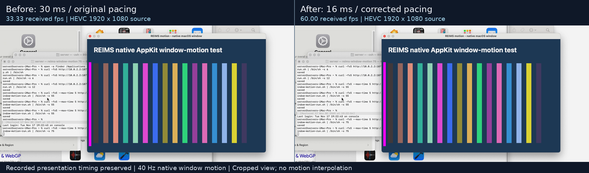

# Capture cadence investigation — 18 November 2026

## Result and scope

Two measurable limits in the experimental REIMS desktop streaming path are corrected:

1. QEMU's software D-Bus listener inherited the generic 30 ms GUI polling interval, limiting capture updates to about 33.3/s.
2. Our Sunshine QEMU D-Bus adapter scheduled its next wait after copying a frame. This added the copying cost to every requested frame period.

With both changes, the paired local receiver measured **59.996 fps** at the unchanged **1920 × 1080, HEVC, requested 60 fps, 15 Mbps** settings. Returning the QEMU interval to 30 ms restored the approximately 33.3 fps limit.

**This verifies a capture/stream cadence improvement. It does not establish that the user's larger periodic desktop twitch is eliminated.** Neither the baseline nor corrected controlled window-motion recording reproduced backward jumps or scanline tearing. The receiver records real encoded video but does not present it on the user's physical client display or traverse the user's network.

This is also **not a new claim that current development reproduces the historical Spotlight corruption**. See the [separate Spotlight revalidation](../spotlight-2026-11-17/README.md): latest-development GUI OFF/ON were both visually clean; the native Clear/self-read experiment remains a bounded diagnostic result. No upstream issue, comment, or pull request was posted as part of this work.

## Fresh source verification

Live development refs were queried on **18 November 2026 at 10:39:39 Asia/Bangkok (03:39:39 UTC)**:

| Component | Development commit |
| --- | --- |
| [REIMS](https://github.com/steelbrain/reims-vgpu/tree/8f8e14af003cc17eaeb5b82e768550b9e001b993) | 8f8e14af003cc17eaeb5b82e768550b9e001b993 |
| [Metal2Vulkan](https://github.com/steelbrain/metal2vulkan/tree/053e789a0e962a09a1c382e68adfb8f2d5fefeba) | 053e789a0e962a09a1c382e68adfb8f2d5fefeba |
| QEMU vendor source | f56d36ff50346f90a6dbf27e2570eeb98bb2387c |
| Local Sunshine integration source | 96cf5eebd2df0a7b0042c081f6e9af32589135e8 |

The VM is a **development-based local integration**, with pre-existing compatibility/Metal2Vulkan changes documented in the [source manifest](source-manifest.json). It is not presented as an unmodified upstream binary. Both cadence experiments use the **same running QEMU process and Rust archive**; only the live D-Bus interval changes within each recording. The self-read Clear diagnostic remains OFF.

## Before/after motion evidence

[Play or download the side-by-side motion clip](motion-cadence-before-after.mp4).

The 6.6-second comparison uses actual decoded HEVC frames from the baseline and corrected recordings. It trims both to approximately matching positions moving right, crops the desktop to the test window region, scales it for comparison, and holds each frame according to its recorded presentation timestamp. The output is a 60 fps presentation container; **no intermediate motion is synthesized and neither source is sped up**. The fixture moves its own native AppKit window at 40 Hz, so 60 received frames/s does not mean 60 distinct window positions/s.

The [clip manifest](motion-comparison.json) records source hashes, selected frame ordinals, crop coordinates, timing method, and the resulting video hash. Full received-frame timing and decoded marker positions are included below; the much larger original HEVC captures are retained in the test workspace and identified by SHA-256.

## Controlled comparisons

The workload is a native AppKit window translating over a fixed desktop. It does not use Finder dragging, resizing, edge snapping, or AppleScript. The previously attempted Finder-drag comparisons were confounded by geometry changes and are not used as evidence here.

Each experiment changes the QEMU interval **30 ms → 16 ms → 30 ms** while the native workload and QEMU process continue. The second experiment uses the corrected Sunshine pacing object. The same Sunshine runtime image, encoder, resolution, bitrate, GPU, and private test receiver are used. Temporary test authentication is separate from the user's normal configuration and is not published.

| Sunshine pacing | QEMU interval | Capture updates/s | Received fps | Maximum receive gap |
| --- | ---: | ---: | ---: | ---: |
| Original, first A | 30 ms | 33.334 | 33.329 | 37.15 ms |
| Original, B | 16 ms | 62.497 | 37.614 | 30.79 ms |
| Original, repeated A | 30 ms | 33.326 | 33.327 | 36.01 ms |
| Corrected, first A | 30 ms | 33.331 | 33.330 | 37.77 ms |
| Corrected, B | 16 ms | 62.494 | **59.996** | **23.41 ms** |
| Corrected, repeated A | 30 ms | 33.322 | 33.394 | 36.59 ms |

The main corrected B window contains **1,620 frames over approximately 27 seconds**. The original-pacing recording decodes **3,481/3,481** frames; the corrected recording decodes **3,698/3,698**. Both decode without warnings, nonconsecutive received frame numbers, unexpected direction reversals, or measured cross-scanline marker mismatches. No receive interval exceeds 60 ms in any of the six settled measurement windows. Native timers reported no interval above 60 ms in either 75-second workload.

Timing windows exclude startup and interval-switch transitions. The first baseline's analysis starts after a one-time startup screenshot; no screenshots were taken inside its reported phase windows. Profiling uses the actual headless readback, completion, console, and UpdateMap path. A native-window presentation callback that does not execute in headless mode was not treated as a capture measurement.

### Remaining limits and tradeoffs

- The faster cadence does **not** prove the larger reported twitch is fixed. User-network jitter, decoder timing, client frame pacing, and physical display behavior were not measured by this local recorder.
- The native fixture updates at 40 Hz. Its ordinary repeated positions and reversals at the ends of its triangle path are expected.
- The 16 ms QEMU timer produces approximately 62.5 updates/s, while Sunshine sends approximately 60 frames/s. In the corrected B phase, capture-presentation gaps reach **32.934 ms**, even though receive gaps stay below 23.41 ms. The comparison clip preserves the recorded presentation timing.
- Reported host-processing latency increases: baseline median/p99 **14.1/16.9 ms**, corrected median/p99 **21.1/30.0 ms**. This is not a claim of lower end-to-end latency.
- The QEMU patch exposes a configurable polling interval; it does not implement automatic consumer-rate negotiation or exact fractional-millisecond polling.
- The experiments ran in a disposable Sequoia 15.8.1 VM with 4 vCPUs, 8 GiB RAM, and an RTX 2080 Ti. The software changes do not contain device-specific tuning, lower resolution, lower bitrate, or a reduced requested frame rate.

## Source fixes

### QEMU D-Bus refresh interval

[Source-applicable QEMU patch](../../patches/EXPERIMENTAL-qemu-dbus-refresh-interval-20261118.patch).

Adds the live QOM property **/objects/dbus-display / refresh-interval**, expressed in milliseconds. The default remains 30 ms; allowed values are 1–1000. Existing listeners receive live changes and new listeners inherit the selected interval. Invalid values 0 and 1001 were rejected without changing the current setting.

Apply the patch from the pinned QEMU source root and rebuild QEMU. After booting it, set the tested 60 fps streaming configuration with:

~~~sh
python3 qmp-set-refresh.py /path/to/qmp.sock 16
~~~

Set 30 to restore the previous capture interval. The included [QMP helper](qmp-set-refresh.py) checks the returned value. The setting is runtime state and must be reapplied after a QEMU restart; the experimental launcher does that.

### Sunshine absolute capture deadlines

[Source-applicable adapter patch](../../patches/EXPERIMENTAL-sunshine-absolute-capture-deadline-20261118.patch).

Apply from the workspace containing the Sunshine and bridge directories. The patch includes the small frame-pacing helper in bridge/src. Capture-copy and push work now occur within the requested frame period. The next deadline advances from the prior deadline; expired slots are skipped rather than followed by a catch-up burst.

The [focused C++ regressions](frame_pacer_tests.cpp) cover fixed and variable copying cost, exact deadlines, missed slots, and timeout recovery:

~~~sh
c++ -std=c++20 -O2 -Wall -Wextra -Werror frame_pacer_tests.cpp -o frame_pacer_tests
./frame_pacer_tests
~~~

The candidate rebuild replaces the capture adapter object while retaining the existing project objects and static project libraries. System link dependencies were recovered from the original runtime; the CUDA SDK version matches the original build. Dynamic relocations were checked inside the actual runtime image. Both source patch checks pass.

## Measurement files

| Evidence | Original pacing | Corrected pacing |
| --- | --- | --- |
| Phase measurements | [JSON](original-pacing/phase-analysis.json) | [JSON](corrected-pacing/phase-analysis.json) |
| Complete decoded-run summary | [JSON](original-pacing/decoded-analysis.json) | [JSON](corrected-pacing/decoded-analysis.json) |
| Encoded-unit reception/presentation timestamps | [CSV.gz](original-pacing/frames.csv.gz) | [CSV.gz](corrected-pacing/frames.csv.gz) |
| Decoded marker positions at four scanlines | [CSV.gz](original-pacing/decoded-positions.csv.gz) | [CSV.gz](corrected-pacing/decoded-positions.csv.gz) |
| Headless pipeline probe events | [CSV.gz](original-pacing/pipeline-events.csv.gz) | [CSV.gz](corrected-pacing/pipeline-events.csv.gz) |
| Native application timing | [Log.gz](original-pacing/native-motion-timing.log.gz) | [Log.gz](corrected-pacing/native-motion-timing.log.gz) |

[Native AppKit fixture](reims-window-motion.m), [decoder/marker analysis](analyze-native-stream.py), and [phase summary calculation](summarize-cadence-phases.py) are included. Analysis scripts use the REIMS_EVIDENCE_ROOT environment variable to locate the retained raw run and profiler directories.

The marker detector accepts only the unique 7–18-pixel magenta stripe and rejects the wider decorative stripes. An earlier, ambiguous-width detector output was discarded and is not used here.

## Runtime disposition

The verified QEMU capture extension and corrected Sunshine binary are active on the experimental development VM with a 16 ms interval. Its normal streaming configuration and existing pairings are retained. The temporary test server was removed, and the owned timing probes were cleaned up. The boot helper selects the same candidate and restores the interval after restart.

Canonical VM configuration and the original disk image were not changed. The source manifest records exact binary hashes and the observed runtime activation. These findings and code are published to the user's field-notes repository before any upstream communication.
