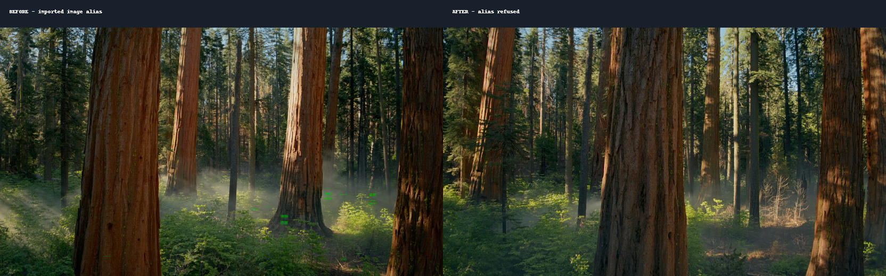

# Exported IOSurface RG16Unorm chroma corruption in 10-bit HEVC video

[Before/after screenshot](before-after.jpg) | [Before](before.jpg) | [After](after.jpg) | [Native Metal reproducer](native-guest-metal-chroma-probe.m) | [Per-frame measurements](numeric-results.json) | [Source manifest](source-manifest.json) | [Patch for Metal2Vulkan 053e789a](../../patches/metal2vulkan-exported-rg16-chroma-053e789a.patch)

## Symptom and finding

The macOS Sequoia 15.8.1 guest running on REIMS showed green rectangular blocks while presenting hardware-decoded 3840 x 2160 HEVC Main10 video. The native guest probe isolated incorrect chroma reads from the **nonzero-offset RG16Unorm plane** of an exported two-plane x420 IOSurface.

The decoded chroma bytes and GPU texture-to-buffer blits were correct; shader sampling through the imported Vulkan sampled-image alias returned wrong U/V values. This indicates an issue in the shader-visible representation used for that plane in this tested integration, rather than a faulty source-video decode.

## Genuine QEMU before/after captures

The left and right frames were read directly from QEMU's graphics head 0 during a controlled same-QEMU-binary alias-enabled/alias-refused experiment, without image editing beyond scaling and labels. The media was moving and the guest booted separately for each mode: **the two pictures show different moments and are not aligned source frames**. The screenshots illustrate the green-block symptom; the sampled pixel comparison below is the correctness control. Both original framebuffer SHA-256 digests are in the [manifest](source-manifest.json).

## Controlled native Metal A/B

Guest-side AVFoundation decoded 12 original 4K HEVC Main10 frames. At each frame the probe sampled 32,400 spatial positions and checked shader-visible Y/U/V against the decoded plane bytes, with independent GPU chroma blit checks.

| Native probe result | Original alias path | Alias-refusal path |
| --- | ---: | ---: |
| Frames | 12 | 12 |
| Bad U/V sample positions per frame | **312–656** | **0** |
| Bad Y sample positions | 0 | 0 |
| Bad GPU chroma blit samples | 0 | 0 |
| Green blocks in moving QEMU capture | Present | Not observed |

The comparison was conducted with the same QEMU executable (SHA-256 in manifest) and the same source media, switching **M2V_DIAG_RG16_SHADOW=0** versus **=1** across fresh scratch guest boots. Tested REIMS was 92953dae; Metal2Vulkan was 0b674f2c1. Hardware decoding remained enabled. The native log's Metal command buffer status 4 denotes completed execution, not a process failure.

Subsequently, the patch was ported to **REIMS 8f8e14a + Metal2Vulkan 053e789a** and the guest 12-frame probe again returned zero incorrect Y/U/V values, with clean moving video. An unpatched A/B on **that exact newer revision** was not rerun; the older controlled A/B and newer patched validation are separate evidence.

The complete 12-frame numeric data, excluding raw private machine logs, is in [numeric-results.json](numeric-results.json).

## Local correction

The [source-applicable patch](../../patches/metal2vulkan-exported-rg16-chroma-053e789a.patch) detects only an **externally backed, nonzero-offset RG16Unorm IOSurface plane** and declines the in-place sampled Vulkan image alias for it. Normal selection can then use direct texel-buffer rows where eligible, or the existing shadow representation when an image is required. Other formats, first planes, ordinary non-exported textures, and hardware decode are unchanged. No unconditional per-frame copy is required for eligible direct-row access.

This patch is generated from Metal2Vulkan **053e789a0e962a09a1c382e68adfb8f2d5fefeba**, modifies only buffer_texture.rs and texture.rs, and was checked to apply to the clean pinned source, producing byte-identical files to the tested local implementation. It does not include the separate Spotlight Clear/self-read diagnostic, NVENC changes, or any local Cargo path overrides.

## Reproducer and limits

The [Objective-C/Metal guest probe](native-guest-metal-chroma-probe.m) uses public AVFoundation, CoreVideo, IOSurface and Metal APIs. It is intended for an x86-64 macOS guest; the media source used for this test was the system-installed Sequoia Sunrise 4K HEVC Main10 asset. The media, firmware, guest OS and executable builds are **not distributed**.

Measurements were performed on a single Linux/NVIDIA RTX 2080 Ti Vulkan host. They do not identify whether the underlying issue is a Metal2Vulkan alias assumption, Vulkan import configuration, or driver-specific behavior in other hardware/software combinations. The source-asset timing, frame-by-frame results, and full framebuffer originals are retained privately; these published screenshots are reduced-resolution excerpts.

No upstream Metal2Vulkan issue, comment or PR was posted when publishing this evidence.
