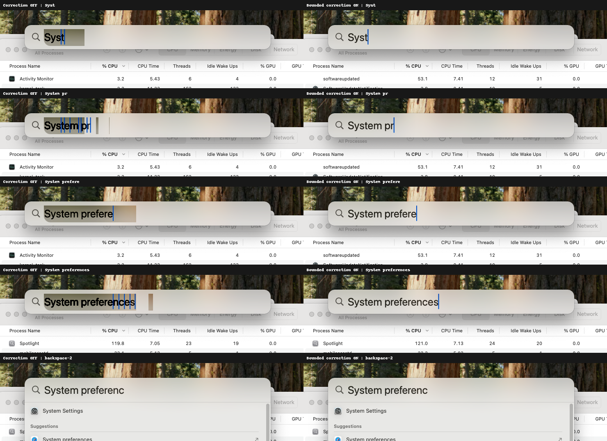
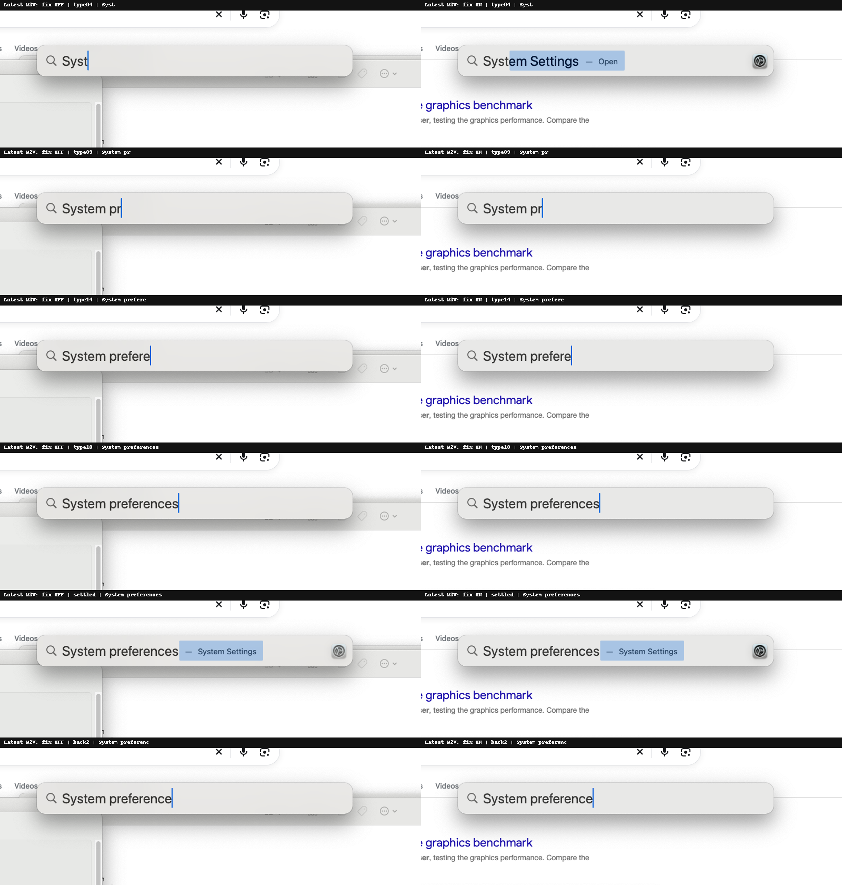

# Spotlight attachment Clear/self-read — current development recheck (17 November 2026)

[**Earlier visible regression**](legacy-2026-10-29-spotlight-off-on.png) · [**Current side-by-side**](latest-2026-11-17-spotlight-off-on.png) · [**Current source patch**](../../patches/EXPERIMENTAL-spotlight-clear-selfread-m2v-053e789a.patch) · [**Native guest Metal test source**](selfread_semantics.c) · [**Structured A/B results**](native-selfread-off-on.json) · [**Source-hash manifest**](source-manifest.json)

## Result: native discrepancy persists; current visible Spotlight corruption was **not reproduced**

On the **same** compiled REIMS/macOS guest QEMU binary, the native Metal Clear/self-read test still shows a measurable difference when the diagnostic compatibility fix is disabled versus enabled. However, our new **actual Spotlight GUI** comparison on current Metal2Vulkan development shows correct typing and a single caret *with the fix both disabled and enabled*. We must not present the older screenshot as proof of a remaining visible problem in this latest runtime.

| Evidence | Diagnostic fix OFF | Diagnostic fix ON |
|---|---|---|
| Historical Spotlight UI **29 Oct**, older integrated runtime | Duplicated blue carets, residual glyph pixels | Single caret, no residual glyph pixels |
| Current Spotlight UI **17 Nov**, latest development | **No visible ghosts in this sequence** | **No visible ghosts in this sequence** |
| Current native Metal 3×40 Clear/self-read | 120/120 prior-color pixels | 120/120 clear-color pixels |
| Current native Metal 144×64 Clear/self-read | 9,216/9,216 prior-color pixels | 9,216/9,216 clear-color pixels |
| Current Load/self-read 3×40 control | 120/120 original-color pixels | 120/120 original-color pixels |
| Current Clear/independent-source 3×40 control | 120/120 original-color pixels | 120/120 original-color pixels |

Native test rows were reproduced **three times per mode**; all command buffers completed with status 4, test exits were zero, and control failures were zero. No physical native-Metal comparison was performed, so the native guest discrepancy should not be described as a proven universal Metal semantics regression.

## Exact source and environment

- Metal2Vulkan source commit: `053e789a0e962a09a1c382e68adfb8f2d5fefeba`.
- REIMS development source commit: `8f8e14af003cc17eaeb5b82e768550b9e001b993`.
- Same QEMU release binary throughout A/B: SHA-256 `66a660688cf6dea1cda06bdb259aa13d90ba2f9acd8dff2e259989364dd42f6a`.
- Guest: macOS Sequoia 15.8.1 (x86-64), 1920×1080 display.
- Host GPU: NVIDIA GeForce RTX 2080 Ti, Linux/Vulkan.
- Controlled change: `REIMS_DIAG_SELFREAD_CLEAR=0` versus `=1`, set when launching the *same* QEMU executable. The screen and input were captured after boot in each mode on the same disposable guest copy-on-write disk.
- The rest of the integrated binary also contains independently tested NVENC API and RG16Unorm chroma compatibility changes; these are **held constant** in the self-read A/B and are **not part of the linked self-read patch**.

## Actual screenshot comparison



*Historical October 29 screenshot: five matched query stages, true QEMU framebuffer captures. The left panel shows stale glyphs and multiple blue carets with the correction OFF. The right panel shows the correction ON. This was an earlier integrated runtime, not the current November 17 revision.*



*Current November 17 screenshot: actual QEMU `screendump` of the REIMS PCI graphics device (`device=gfx, head=0`), six matched stages on each side. The guest was operated via VNC using the actual Spotlight shortcut **Control+Space** (NOT Command+Space), typing `System preferences` and backspacing. The two sides show different background window content and transient Spotlight autocomplete (not a controlled framebuffer pixel-difference test), but **neither shows the old duplicate-caret/glyph failure**. No synthetic pixels or staged Spotlight imagery were used.*

The raw source captures and per-keystroke timing were retained internally; only the above cropped, nonprivate evidence panels are published.

## Patch applicability and limitations

The patch [`EXPERIMENTAL-spotlight-clear-selfread-m2v-053e789a.patch`](../../patches/EXPERIMENTAL-spotlight-clear-selfread-m2v-053e789a.patch) is the **November 17 adaptation** of the earlier October 29 research patch to the listed current Metal2Vulkan source. It changes only `crates/metal2vulkan-runtime/src/render.rs` and adds `render/selfread_clear.rs`. It records a narrow, bounded correction to the sampled shadow of an attachment whose first draw reads its own Clear-loaded color; other Load actions and independent sources are intentionally untouched.

It has eight passing focused CPU unit tests and the above native guest A/B. **This is an opt-in diagnostic patch, not a merge-ready upstream implementation.** A proper upstream resolution should integrate the correct load-action semantics in the render pipeline, without a permanent application-specific flag. The existing upstream issue is [Metal2Vulkan #17](https://github.com/steelbrain/metal2vulkan/issues/17); as of this snapshot, the maintainer had acknowledged it. We have not posted this update to the upstream issue.

To inspect or replay from the pinned clean Metal2Vulkan checkout:

```sh
git checkout 053e789a0e962a09a1c382e68adfb8f2d5fefeba
git apply --check EXPERIMENTAL-spotlight-clear-selfread-m2v-053e789a.patch
git apply EXPERIMENTAL-spotlight-clear-selfread-m2v-053e789a.patch
cargo test --release --lib -p metal2vulkan-runtime render::selfread_clear::tests
```

The patch filename above should be supplied with its actual absolute or relative path from this archive. For a direct native Metal reproduction inside the macOS guest, compile `selfread_semantics.c` using macOS Clang (x86-64) and link against `System` and `objc`:

```sh
xcrun --sdk macosx clang -arch x86_64 -mmacosx-version-min=14.0 -O2 -w \
    selfread_semantics.c -o selfread-probe -lSystem -lobjc
./selfread-probe
```

### What this does **not** establish

It does not prove a contemporary Spotlight ghosting regression, prove Apple native-Metal conformance on physical hardware, show whether the fix improves performance, or establish that it is safe to enable the diagnostic for every rendering pattern. It *does* provide reproducible native guest behavior, source applicable to current development, and an honest visible screenshot comparison.

All source and observations are from a single machine. No private guest disks, user credentials, host paths, IP addresses, Apple binaries, GPU UUIDs, or raw private UI captures are published.
